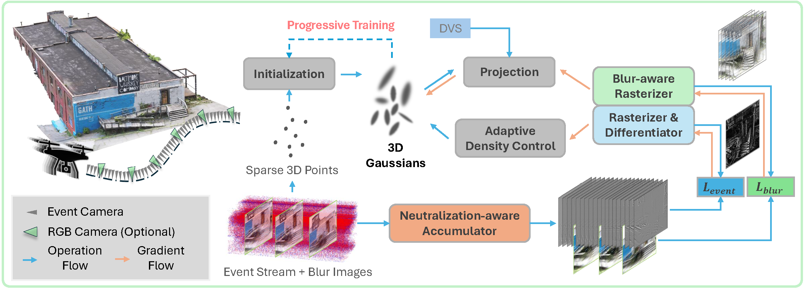

# Event3DGS: Event-Based 3D Gaussian Splatting for High-Speed Robot Egomotion

[Project page](https://tyxiong23.github.io/event3dgs/) · [Paper](https://arxiv.org/abs/2406.02972) · CoRL 2024

Event3DGS is a framework for reconstructing high-fidelity 3D structure and appearance from event streams under high-speed camera egomotion. It combines the temporal resolution of event cameras with differentiable 3D Gaussian Splatting, event-based differential supervision, and progressive training. An optional appearance refinement stage incorporates a small number of motion-blurred RGB images while preserving the reconstructed geometry.



## Installation

Requirements: Linux, an NVIDIA GPU, CUDA Toolkit 12.1 (`nvcc`), and a C++17 compiler.

```bash
git clone https://github.com/tyxiong23/Event3DGS.git
cd Event3DGS

conda create -n event3dgs python=3.9 pip=24.3 setuptools=69.2 wheel -y
conda activate event3dgs
conda install pytorch=2.1.2 torchvision=0.16.2 pytorch-cuda=12.1 "mkl<2024.1" -c pytorch -c nvidia -y

pip install -r requirements.txt
pip install --no-build-isolation --no-deps ./submodules/diff-gaussian-rasterization ./submodules/simple-knn
```

## Usage

Download the synthetic or real [EventNeRF datasets](https://github.com/r00tman/EventNeRF) and extract them to your data directory. Both use the same input format; see [data preparation](docs/DATA.md) to adapt your own data.

### Training

Train an event-only model from random point initialization:

```bash
DATA_ROOT=/absolute/path/to/EventNeRF/data

CUDA_VISIBLE_DEVICES=0 bash scripts/train.sh \
    "$DATA_ROOT/nerf/lego" output/lego_single \
    --iterations 30000 --no_ply --pcd_scale 0.2 \
    --max_winsize 50 --event_delta 0.25 --tonemap_eps 0.1 --rand_ratio 0.7
```

For a real sequence:

```bash
CUDA_VISIBLE_DEVICES=0 bash scripts/train.sh \
    "$DATA_ROOT/nextnextgen/plant" output/plant_single \
    --iterations 30000 --no_ply --pcd_scale 0.1 \
    --max_winsize 50 --event_delta 0.1 --rand_ratio 0.7
```

Models are saved to `output/lego_single/point_cloud/iteration_N/point_cloud.ply`. Use `python train_event.py --help` for training options. To save optimizer checkpoints, add `--checkpoint_iterations`; use `--start_checkpoint` to resume a saved checkpoint with the same training settings.

### Progressive Training

Run two rounds of 30,000 iterations each:

```bash
CUDA_VISIBLE_DEVICES=0 ROUNDS=2 ITERATIONS=30000 OPACITY_THRESHOLD=0.9 \
    bash scripts/train_progressive.sh \
    "$DATA_ROOT/nerf/lego" output/lego_progressive \
    --no_ply --pcd_scale 0.2 --max_winsize 50 \
    --event_delta 0.25 --tonemap_eps 0.1 --rand_ratio 0.7
```

Each round is saved under `output/lego_progressive/round_N`. Subsequent rounds initialize Gaussian centers from the preceding round's high-opacity Gaussians and reset the remaining parameters and optimizer. Set `ROUNDS`, `ITERATIONS`, and `OPACITY_THRESHOLD` to control this schedule, and use a new output directory for each run.

### Evaluation

Render the validation views and compute PSNR, SSIM, and LPIPS:

```bash
bash scripts/render.sh output/lego_progressive/round_2
bash scripts/evaluate.sh output/lego_progressive/round_2/test/ours_30000 \
    --alignment log
```

The renderer loads the latest saved iteration by default; add `--iteration N` to select another iteration. Predictions, ground-truth images, and `metrics_log.json` are saved under `MODEL_DIR/test/ours_N/`. For a single-round model, replace the model directory with `output/lego_single`.

Event measurements constrain changes in log intensity, leaving the absolute radiance scale ambiguous. Following [EventNeRF](https://github.com/r00tman/EventNeRF), we account for this ambiguity by fitting a per-channel affine correction in log intensity using the evaluation predictions and ground truth before computing metrics (`--alignment log`). Use `--alignment none` for raw prediction scores, or `--skip_lpips` to compute only PSNR and SSIM.

For optional refinement with motion-blurred RGB observations, see [appearance refinement](docs/DATA.md#appearance-refinement).

## Release Progress

- [x] Release the paper and project page
- [x] Release the initial Event3DGS source code
- [x] Provide installation instructions and usage examples
- [ ] Clean up and release the implementations of neutralization-aware event slicing and sparsity-aware sampling.

## Citation and acknowledgments

```bibtex
@inproceedings{xiong2024event3dgs,
  title     = {{Event3DGS}: Event-Based 3D Gaussian Splatting for High-Speed Robot Egomotion},
  author    = {Xiong, Tianyi and Wu, Jiayi and He, Botao and Fermuller, Cornelia and
               Aloimonos, Yiannis and Huang, Heng and Metzler, Christopher A.},
  booktitle = {8th Annual Conference on Robot Learning},
  year      = {2024},
  url       = {https://arxiv.org/abs/2406.02972}
}
```

We acknowledge [3D Gaussian Splatting](https://github.com/graphdeco-inria/gaussian-splatting), its differentiable rasterizer and simple-knn, and [EventNeRF](https://github.com/r00tman/EventNeRF) for the underlying rendering framework and event dataset conventions. Please also cite these works when using their components or data.
